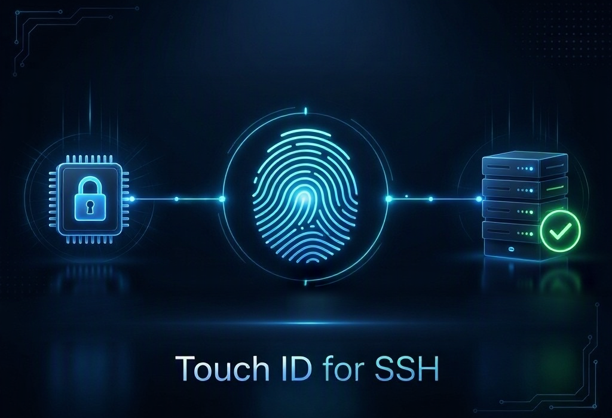
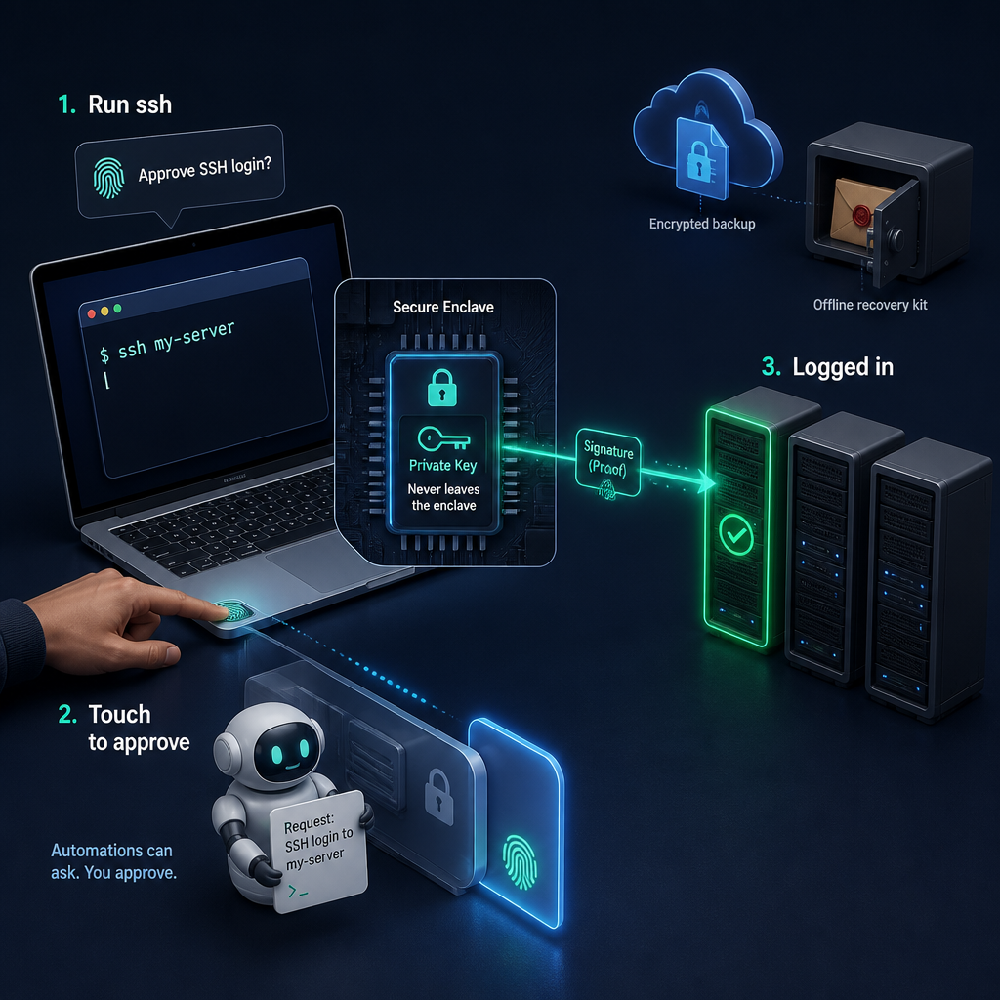

<p align="center">
  
</p>

# Touch ID SSH Agent for macOS

An SSH agent for macOS that keeps the key in the **Secure Enclave** and requires **Touch ID for every signature**. The `ssh` client stays the same, and the server only needs the public key in `authorized_keys`.

> Status: experimental (0.2.0). It does not replace an access recovery plan: always keep a second authorized key on the server (see [Recovery](#recovery)).
>
> 0.2.0 adds temporary SSH access for AI agents (Phase 2). Its real Touch ID approval under launchd passed the interactive `make test-touchid`; locked-screen, sleep/wake and logout behavior still need a manual check. See the [implementation record](docs/phase-2-implementation.md).

## What problem does it solve?

SSH keys are the right way to reach your servers: safer than passwords and just as easy to use. But a regular SSH key is a file in `~/.ssh`, and a file can be copied. If someone steals it, or you lose the computer, you have to create a new key and log in to every server twice: once to install the new key and once to remove the old one. With new vulnerabilities published every day and poisoned development packages that harvest credentials from developer machines, a stolen key is a real risk, not a theoretical one.

touchid-ssh-agent keeps the convenience of SSH keys and gets rid of the file:

- **Nothing to steal.** The key is created inside the Mac's Secure Enclave and never leaves it. Malware or a compromised package that copies `~/.ssh` finds nothing it can use.
- **Touch ID for every SSH login.** Each signature with your key needs your fingerprint, with no "remember me" window. Even an unlocked Mac is not enough without your finger. (Temporary access, below, is the one thing you approve for a limited time instead.)
- **AI agents and scripts can ask, but only you approve.** The prompt shows who asked (`ssh ← zsh ← claude`) and, when the server supports it, where to.
- **One command per server.** `authorize` installs both your Touch ID key and your emergency key, checks that the Touch ID login works, and records the server.
- **An inventory of your access.** Every server you authorize is listed, so you always know where your keys are installed.
- **An encrypted backup in your cloud.** After every `authorize`, an encrypted copy of the inventory goes to a cloud-synced folder of your choice. Only your emergency kit can open it.
- **An emergency kit for the day the Mac is gone.** A passphrase-protected key that you keep outside the Mac, already installed on every server.
- **One-command recovery.** On a new Mac, `recover` uses the kit to open the inventory, installs the new Mac's keys on every server, removes the lost Mac's key (and its temporary-access CA), replaces the emergency key if you choose to, and finishes with an audit. `recovery test` rehearses it without changing anything.
- **ssh config included.** `authorize` offers to add a `Host` block, with a short name of your choice, so `ssh NAME` goes through Touch ID; `audit` checks that it is still there.
- **Audits.** `audit` checks that every server in the inventory still has both keys and, on servers enrolled for temporary access, that the CA line keeps its scope.
- **Temporary SSH access for AI agents.** Approve selected servers for a limited time with one Touch ID, then let an agent make repeated SSH connections during the day or overnight: `access app-server,worker-server --for 2h`. Your login key keeps asking for Touch ID every time. See [Temporary SSH access](#temporary-ssh-access).
- **Instructions for AI agents, built in.** `touchid-ssh-agent instructions` prints, for the agent, how to use this tool: check, request and use temporary access, and what to do on denial or expiry. One command adds a pointer to it to your agent's `CLAUDE.md` or `AGENTS.md`. See [Instructions for AI agents](#instructions-for-ai-agents).
- **Standard OpenSSH, nothing to install on servers.** It works with the `ssh` and `git` you already use; servers only need public keys in `authorized_keys`.
- **No account, no service, no telemetry.** Everything runs on your Mac, and the code is open source.

### Coming next

Here is what may come next. Star or watch the repository to follow along, and share your ideas in [Discussions](https://github.com/allankz/touchid-ssh-agent/discussions/categories/ideas).

- **More temporary-access options**, as needed: several grants at once, an absolute `--until`, per-server permissions, scoped port forwarding, and servers behind jump hosts.

## How it works

<p align="center">
  
</p>

```text
ssh (or git, or an AI agent running ssh)
   │  Unix socket ~/.touchid-ssh-agent/agent.sock (ssh-agent protocol)
   ▼
touchid-ssh-agent  ──►  Touch ID (LocalAuthentication, fresh context per request)
   │
   ▼
Secure Enclave: signs; the private key never leaves the chip
```

- The key is ECDSA P-256 (`ecdsa-sha2-nistp256`), generated **inside** the Secure Enclave.
- `~/.touchid-ssh-agent/identity.se` only holds a blob encrypted by the Secure Enclave. It does not work on any other Mac and cannot be turned into a private key.
- The Touch ID requirement is sealed into **the blob itself** by the Secure Enclave. Changing the file or the program does not remove it.
- Every signature request creates a fresh authentication context. There is no reuse, no silent mode and no "remember for N minutes".
- If nobody approves within 60 s, the request is denied.

[Temporary access](#temporary-ssh-access) works differently, on purpose: one Touch ID lets a separate, short-lived key log in to the servers you chose until a deadline. The agent above and its key are not involved.

### What the Touch ID prompt shows

macOS shows something like:

> “touchid-ssh-agent” is trying to **log in over SSH as admin to server.example, requested by ssh ← zsh ← claude**.

- **Remote user**: what `ssh` put in the authentication request.
- **Server**: when the server supports `publickey-hostbound` (OpenSSH ≥ 8.9), the signature is bound to the server's host key, and the agent looks up the matching name in your `~/.ssh/known_hosts`. Without that binding the prompt names no server, because the protocol gives no way to confirm the destination.
- **Requester**: the chain of local processes that opened the socket (`ssh ← zsh ← Terminal`). It is a hint, not proof.
- SSH-signed git commits show up as "sign a git commit or tag".

The words around the reason ("is trying to") come from macOS in the system language.

## Requirements

- A Mac with Touch ID (Apple Silicon or T2) running macOS 13 or later.
- Swift 5.10 or later. The Command Line Tools are enough: `xcode-select --install`.
- [age](https://age-encryption.org) for the encrypted inventory backup: `brew install age`.

## Installation

```bash
make install                        # builds and copies to ~/.local/bin
touchid-ssh-agent setup             # Touch ID key, cloud backup folder, emergency kit
touchid-ssh-agent install           # registers the LaunchAgent (starts with your session)
touchid-ssh-agent authorize user@server -p 22
touchid-ssh-agent status
```

`authorize` connects **with the access that already works** (a password or another key), adds both the Touch ID key and the emergency key to the server's `authorized_keys`, checks that the Touch ID key logs in, and records the server in the inventory. If your current access needs extra ssh options, pass them after `--`, for example `-- -i ~/.ssh/old_key`. If the server has a `Host` alias in your `~/.ssh/config`, authorize the alias rather than its IP, so its port and options apply. ssh may ask for the server's password or to confirm its host key on this first connection; once the keys are installed, logins only need Touch ID. At the end, `authorize` shows the `Host` block for the server and offers to add it to `~/.ssh/config`, asking for a short name when the server has none, so you can type `ssh NAME`.

Generate the `~/.ssh/config` block. The command only prints it and changes no file:

```bash
touchid-ssh-agent config my-server --host server.example --user admin --port 22
```

```sshconfig
Host my-server
  HostName server.example
  User admin
  Port 22
  IdentityAgent ~/.touchid-ssh-agent/agent.sock
  IdentityFile ~/.touchid-ssh-agent/id_ecdsa_se.pub
  IdentitiesOnly yes
  ForwardAgent no
```

`IdentityFile` points to the **public** key on purpose. With `IdentitiesOnly yes`, `ssh` only uses the keys listed there. When it finds the public key, it asks the agent for the signature. Without that line, `ssh` would never offer the Secure Enclave key.

From then on, `ssh my-server` asks for Touch ID.

### Signing git commits

git signs with `ssh-keygen -Y sign`, which looks for the agent in `SSH_AUTH_SOCK`. It does not read `IdentityAgent` from `ssh_config`. To use Touch ID for commits without replacing the system's default agent, point git to a small wrapper:

```bash
printf '#!/bin/sh\nSSH_AUTH_SOCK="$HOME/.touchid-ssh-agent/agent.sock" exec /usr/bin/ssh-keygen "$@"\n' > ~/.local/bin/ssh-keygen-touchid
chmod +x ~/.local/bin/ssh-keygen-touchid
git config --global gpg.format ssh
git config --global gpg.ssh.program ~/.local/bin/ssh-keygen-touchid
git config --global user.signingkey ~/.touchid-ssh-agent/id_ecdsa_se.pub
git config --global commit.gpgsign true
```

## Upgrading

```bash
git pull
make install
launchctl kickstart -k gui/$(id -u)/local.touchid-ssh-agent
```

`touchid-ssh-agent version` shows which version is installed. Upgrades are additive. A new version never undoes what you have already set up:

- **Your Touch ID key keeps working.** The Secure Enclave blob is not tied to a particular build of the binary.
- **Keys already installed on your servers stay valid.** No server needs to be touched after an upgrade.
- **Your emergency kit, inventory and backup folder keep working.** File formats only gain optional fields, so every later version reads what earlier versions wrote.
- **New features arrive as new commands or options.** If a change ever needs an action from you, it will be an explicit command you choose to run, never a side effect of upgrading. Temporary access, for example, changes no server until you run `authorize HOST --temporary-access` for it.

## Emergency kit and inventory

The Touch ID key cannot leave this Mac. If the Mac is lost, stolen or broken, or if your fingerprints change under the `current-set` policy, that key is gone. The emergency kit is how you get back in.

- **The kit is one file**: an Ed25519 SSH key **encrypted with your emergency passphrase**, followed by plain-text recovery instructions. `ssh -i` and `age -i` accept the file as it is.
- **The file is useless without the passphrase.** The key is encrypted in OpenSSH's own format with a deliberately slow key derivation (bcrypt, 200 rounds), and the generated passphrase has about 119 bits. So the kit does not need a password manager: a USB drive, an email to yourself or a printout work too, as long as **the passphrase is kept somewhere else**. The instructions part names fingerprints and your backup folder, but no secret.
- **`setup` shows a random passphrase once** and asks you to retype it, then reveals the kit in Finder. Once you have stored the kit outside this Mac and typed `SAVED`, the copy on the Mac is erased and only the public key stays.
- **Every `authorize` installs both keys.** The emergency key is never left out.
- **The inventory** (`~/.touchid-ssh-agent/inventory.json`) lists every authorized server. A copy, `inventory.age`, goes to the backup folder you chose, ideally one synced to the cloud. It is encrypted with age to the emergency key, so this Mac can update it but only the kit can read it. If the Mac is stolen, that copy is how you find your servers again.
- **`audit`** logs in to every server in the inventory (one Touch ID each) and checks that both keys are still there, and the CA's scope on servers enrolled for temporary access.

Already have an emergency key, for example one kept in your password manager? Import its public half with `touchid-ssh-agent recovery import key.pub` (ed25519 or rsa). Change the backup folder at any time with `touchid-ssh-agent set backup-path DIR`.

### If the Mac is gone

On the new Mac:

```bash
git clone https://github.com/allankz/touchid-ssh-agent && cd touchid-ssh-agent
make install                                   # also installs age
touchid-ssh-agent recover ~/emergency-kit.txt
```

Run `recover` before you `authorize` any server on the new Mac: once that Mac's own inventory lists a server, the next backup it writes replaces the old Mac's `inventory.age` in a shared backup folder.

`recover` does the rest, in this order:

1. **Opens the kit.** It asks for the kit's passphrase twice, one right after the other, for security: age opens the inventory and ssh-add loads the emergency key. It finds `inventory.age` from the folder named in the kit, or asks where it is. The passphrase is not asked again after that.
2. **Checks everything, changing nothing on the servers.** It creates this Mac's Touch ID key if needed (and its temporary-access CA, when some server trusts the lost Mac's CA), starts the agent, and logs in to every server with the emergency key.
3. **Asks whether to replace the emergency key.** Replace it if anyone else may have seen the kit or its passphrase: you save a new kit with a new passphrase, and the old key is removed from every server. Keep it, and nothing new is created: the kit you used stays your emergency kit.
4. **Moves the servers**, after you type `RECOVER`. For each server, it logs in with the emergency key and adds this Mac's keys, checking the server's host key against the one in the inventory. Then it checks the Touch ID login (one Touch ID), and only then removes the lost Mac's key (and the old emergency key, if you replaced it). The keys it removes are matched by their exact fingerprints, so nothing else in `authorized_keys` is touched.
   On servers enrolled for temporary access, it also adds this Mac's CA with the same principal and restrictions, and checks a real certificate login through it with a short-lived validation certificate (one Touch ID for all of them; the certificate grants nothing and is never saved). Once the new Touch ID login works, every CA of the lost Mac the inventory recorded is removed too, by its exact key: only that Mac could use it. If the certificate check fails (the server refuses certificates, its clock is far off, you deny the prompt), nothing old is kept because of it: the server is marked "temporary access not confirmed", and `authorize HOST --temporary-access` finishes it later. `--keep-emergency-key` never keeps the lost Mac's CA. Old temporary grants and their aliases are not restored.
5. Offers the `ssh` config blocks, writes the new inventory backup (only when every server moved) and runs `audit` (one more Touch ID per server).

Before changing anything, `recover` keeps a dated copy of the backup the kit opens (`inventory-before-recovery-DATE.age`), and it records each server in this Mac's inventory as soon as that server is done. If a server fails (it cannot be reached, or the new Touch ID login does not work), its old keys and CA stay, the cloud backup is left as it was, and running `recover` again skips the servers already moved. If a run is interrupted after a server changed, the next run finishes that server, through this Mac's Touch ID key when the kit no longer opens it. If a later command rewrote the backup in the meantime, point `--inventory` at the dated copy. Removing the CA line from `authorized_keys` retires the lost Mac's certificates there; trust configured elsewhere on a server (for example `TrustedUserCAKeys`) is not checked.

`touchid-ssh-agent recovery test emergency-kit.txt` checks, without changing anything, that the kit still opens every server. Run it now and then.

Without a Mac, from any computer with OpenSSH and age:

```bash
chmod 600 emergency-kit.txt
age -d -i emergency-kit.txt inventory.age     # server list; asks for the passphrase
ssh -i emergency-kit.txt -p PORT USER@HOST    # asks for the passphrase
```

Then remove the lost Mac's login key from each server (`ssh-keygen -lf ~/.ssh/authorized_keys` shows each line's fingerprint) and, where the inventory shows `temporaryAccess`, the `cert-authority` lines whose fingerprint is its `caFingerprint` (and those named in its `caRotation`, if it has one). Then set up the new Mac, `authorize` every server again, and retire the emergency key you used. Both paths are written inside the kit (kits created before this version describe the login key only).

## Commands

`touchid-ssh-agent help` groups the commands the same way.

**Getting started**

| Command | What it does |
| --- | --- |
| `setup [--biometry current-set\|any] [--comment T]` | Guided setup: Touch ID key, backup folder, emergency kit. |
| `install [--force]` | Registers the `local.touchid-ssh-agent` LaunchAgent, so the agent starts with your session. |
| `authorize [user@]host [-p P] [-F FILE] [--alias A] [--temporary-access] [-- SSH_ARGS]` | Installs both keys, checks the Touch ID login, offers the ssh config block, updates the inventory and its backup. `--temporary-access` also enrolls the server for temporary access (see below). |

**Day to day**

| Command | What it does |
| --- | --- |
| `status` | Secure Enclave, Touch ID (including password lockout), identity, agent, LaunchAgent, emergency key, backup folder, inventory, FileVault, and the temporary-access CA, pending CA replacements and active grant. |
| `inventory` / `audit [NAME...]` | Lists the servers (with their temporary-access enrollment and latest grant) / checks both keys, the CA's scope and the ssh config of each server. |
| `deauthorize NAME... \| --all [-F FILE] [-p P] [-- SSH_ARGS]` | Removes this Mac's keys and CA trust line from servers and drops them from the inventory. `--all` does every server, then offers to delete the Touch ID key. |
| `config ALIAS --host H [--user U] [--port P]` | Prints the `ssh_config` block. |
| `set backup-path DIR\|none` | Sets or clears the backup folder for `inventory.age`. |

**Temporary access**

| Command | What it does |
| --- | --- |
| `access HOST[,HOST...] --for DURATION [--force-command C] [--allow-pty] [--json]` | Requests a temporary grant; one Touch ID approves issuance. |
| `access status [--json]` | Shows validity, selected targets, aliases and exact SSH commands. Never prompts. |
| `access stop [--json]` | Stops the active grant and removes its local generated files. |
| `access cleanup [--json]` | Removes files left by grants that ended abnormally; keeps live, valid grants. |
| `access help` | Detailed help: enrollment, aliases, cleanup and limits. |
| `instructions [--snippet \| --add-to FILE]` | The Markdown workflow for AI agents; `--snippet` prints a short block for `CLAUDE.md` or `AGENTS.md`, and `--add-to` writes it into that file after asking. |

**New Mac and recovery**

| Command | What it does |
| --- | --- |
| `migrate` | Shows, with this Mac's own data, how to move to a new Mac and what to fix first. Changes nothing. |
| `recovery test KIT [--inventory FILE] [-F SSH_CONFIG]` | Checks that the kit still opens every server, and reports each server's recorded CA trust. Changes nothing. |
| `recover KIT [--inventory FILE] [-F SSH_CONFIG] [--keep-emergency-key]` | On a new Mac, moves every inventory server to this Mac (keys and CA trust), then audits. `--keep-emergency-key` answers Keep without asking. |
| `recovery create [--replace] [--own-passphrase]` | Creates a new emergency kit. |
| `recovery import FILE.pub [--replace]` / `recovery pubkey` | Uses an existing emergency key / prints the emergency public key. |

**Advanced**

| Command | What it does |
| --- | --- |
| `create [--comment T] [--biometry current-set\|any]` | Creates only the Touch ID key. Refuses if one already exists. |
| `pubkey` / `fingerprint` | Prints the public key or its SHA256 fingerprint. |
| `version` | Prints the installed version. |
| `agent` | Runs the agent in the foreground (useful for debugging). |
| `uninstall` | Removes the LaunchAgent. The keys are kept. |

`deauthorize` reaches each server with your usual ssh access (one Touch ID when that goes through this agent; pass `-- -i OTHER_KEY` to use another key). It removes only the lines holding this Mac's Touch ID key, emergency key and temporary-access CA (and a lost Mac's CA still waiting for removal there), matched exactly, and leaves every other line alone. If no other key would be left on the server, it stops and asks first, because afterwards only a password or your provider's console would get you in. The old `delete` command now points to `deauthorize --all`.

By default everything lives in `~/.touchid-ssh-agent/`. Set `TOUCHID_SSH_AGENT_DIR` to use another directory (keep it short: grant sockets live four levels below it and Unix socket paths are limited to 104 bytes). Touch ID must be approved within 60 s; to change that, set `TOUCHID_SSH_AGENT_PROMPT_TIMEOUT` (in seconds) in the agent's environment, or in the shell that runs `access`, `authorize` or `recover` for the CA's prompts.

| File | What it is |
| --- | --- |
| `identity.se`, `id_ecdsa_se.pub`, `agent.sock`, `agent.log` | The Touch ID login key (Secure Enclave blob and public key), the agent's socket and log. |
| `recovery.pub`, `inventory.json`, `config.json` | Emergency public key, inventory and settings. |
| `ca.se`, `ca.pub`, `ca.serial` | The temporary-access CA (a second Secure Enclave key, Touch ID with today's fingerprints), its public key and certificate serial counter. Created by the first `authorize --temporary-access`. |
| `access/grants/GRANT-ID/` | One grant's socket, public key, certificate, `ssh_config`, pinned `known_hosts` and ownership manifest. Removed when the grant ends. |
| `access.log`, `access.stderr.log` | Grant events: issuance, signatures (time and requesting process), expiry and stop. No keys, payloads, hosts or accounts. |
| `inventory.lock`, `ca.serial.lock`, `access/lifecycle.lock` | Empty lock files that keep concurrent commands from overwriting each other. |

### Biometry policies

- `current-set` (default): only the fingerprints enrolled today. **Adding or removing a fingerprint invalidates the key forever.** This is the strictest option.
- `any`: any fingerprint enrolled now or later. The key does not need to be recreated when fingerprints change.

Neither accepts the Mac password as a fallback for Touch ID.

## Temporary SSH access

Approve selected servers once, for a limited time, and let a person or an AI agent make repeated SSH connections without more Touch ID prompts. Your login key keeps asking for Touch ID on every use; temporary access uses separate, short-lived credentials.

**Enroll each server once.** Using the access you already have:

```bash
touchid-ssh-agent authorize app-server --temporary-access
```

This adds a third line to the account's `authorized_keys`, next to your login and emergency keys: this Mac's **CA**, a second Secure Enclave key, trusted only for that account's own principal and with forwarding and user rc files denied:

```text
cert-authority,principals="access-3f9c…",no-agent-forwarding,no-port-forwarding,no-X11-forwarding,no-user-rc ecdsa-sha2-nistp256 AAAA… touchid-ssh-agent-ca@mac
```

After the usual Touch ID login check, it checks a real certificate login (one more Touch ID, for a validation certificate that grants nothing) and records the CA trust in the inventory and its encrypted backup. The server's host key must already be in `known_hosts`, because grants pin it. `access` never changes a server by itself; `audit` keeps checking the line's scope, and `deauthorize` removes it.

**Request access.** One Touch ID approves one certificate for all the servers you list:

```bash
touchid-ssh-agent access app-server,worker-server --for 2h
```

- Servers can be inventory names, ssh aliases or `user@host` (use the name or alias for a nonstandard port); every one is checked before Touch ID, and one unknown or unenrolled server fails the whole request. `--for` is required and at most 12 hours.
- The summary shows each account, the exact expiry (local time and UTC) and the permissions. By default the accounts may run any command; `--force-command` limits every login to one command. No PTY unless `--allow-pty`; agent, port and X11 forwarding are always denied.
- A separate one-shot launchd job generates a fresh Ed25519 key in its own memory, has the CA sign a certificate for it, then checks that every server accepts it (an authentication-only login, so no command runs) before the grant is reported as active. One grant is active at a time.

**Use it.** Each server gets a dated alias, such as `app-server-access-20261015-a1b2c3d4e5f6`, defined in the grant's own `ssh_config`. Your `~/.ssh/config` is not changed:

```bash
ssh -F ~/.touchid-ssh-agent/access/grants/20261015-a1b2c3d4e5f6/ssh_config app-server-access-20261015-a1b2c3d4e5f6 uptime
```

That config offers only the grant's key and certificate, pins the host keys recorded in the inventory, and disables forwarding and connection sharing. `access status` prints the exact commands (`--json` gives them as argv arrays).

**When it ends.** At expiry, or after `access stop`, the job stops signing and removes its socket, key, certificate and config; old commands then fail instead of falling back to other keys, and servers reject the certificate after its expiry on their own. A crash, logout or reboot ends the grant too: nothing restarts it, and `access cleanup` (or the next request) removes what it left. **Expiry and stop block new logins only**: sessions and commands already running continue, and changes made on the servers stay.

**For AI agents**, the same workflow is built into the tool: `touchid-ssh-agent instructions` (see [Instructions for AI agents](#instructions-for-ai-agents)).

While a grant is active, the Mac does not idle-sleep (the screen still locks and the display still sleeps). Closing the lid, a forced sleep or a power loss still interrupt it, and the deadline keeps counting while the Mac sleeps.

**If the CA stops working.** The CA uses the `current-set` policy, so adding or removing a fingerprint invalidates it, and `access` fails with `ca_unusable`. Move `ca.se` and `ca.pub` out of `~/.touchid-ssh-agent`, then run `authorize HOST --temporary-access` for each enrolled server: the first run creates a new CA, and each run installs it, checks it and removes the old one from that server.

## AI agents and automation

An AI agent (or script) running on your Mac **can request** a signature through the socket, but it **cannot approve** it: every request opens Touch ID for you.

- It does not read the private key, and it cannot. The key does not exist outside the Secure Enclave.
- If you deny or ignore the prompt, authentication fails.
- The prompt shows who asked (`ssh ← zsh ← claude`) and, when possible, where to.
- Agents running off the Mac (cloud, a container without the socket mounted, another machine) cannot reach the agent.
- For unattended work, an agent can request [temporary access](#temporary-ssh-access) for named servers and a limited time; you approve it once with Touch ID.

The agent only accepts connections from your own user (UID checked on the socket). The socket has mode `0600`, inside a `0700` directory.

### Instructions for AI agents

The tool explains itself to AI agents. There is a command for that:

```bash
touchid-ssh-agent instructions
```

It prints, in Markdown, everything an agent needs to use temporary SSH access correctly: check `access status --json` first, request the fewest servers for the shortest time, wait for your Touch ID, run exactly the returned `ssh_argv`, and what to do on each error (never retry a denied prompt in a loop or fall back to other keys). It ships inside the installed binary and always describes that version: no repository, plugin or MCP service needed.

| Command | For | What it does |
| --- | --- | --- |
| `instructions` | the agent | Prints the full workflow for the installed version. |
| `instructions --snippet` | you | Prints a short block for `CLAUDE.md`, `AGENTS.md` or similar that tells the agent to run `instructions`. |
| `instructions --add-to FILE` | you | Adds that block to `FILE`, or updates it, after showing it and asking. |

So agents find it on their own, add the block once to the file your agent reads:

```bash
touchid-ssh-agent instructions --add-to ~/.claude/CLAUDE.md    # Claude Code
touchid-ssh-agent instructions --add-to ~/.codex/AGENTS.md     # Codex
```

Running it again updates the same block instead of adding another. For anything else (a project's `AGENTS.md`, another agent's settings), paste the output of `instructions --snippet`. Main help (`touchid-ssh-agent help`) also points agents to `instructions`. See [docs/ai-agents.md](docs/ai-agents.md) for the same workflow and the block.

## Known limitations

- Someone who already controls your user session can trigger requests and try to trick you into approving. Read the prompt before touching the sensor.
- Without `publickey-hostbound`, the agent cannot know the destination. The name shown comes from `known_hosts`, not from a check of its own.
- The process chain can be stale if the process exited and its PID was reused. That is why it only informs and never decides.
- One identity per Mac in this version.
- If a server's host key changes (for example, after a reinstall), run `authorize` or `audit` for it again so the inventory records the new key: `recover` refuses a host key that differs from the recorded one.
- `ForwardAgent` re-exposes the agent to the remote server. Keep it off, even with Touch ID.
- Temporary access: any process of your macOS user can use an active grant, and its key is a software key in the grant job's memory. Expiry, stop and CA removal block new logins; they do not end sessions already open or undo changes. A grant is not a sandbox: the selected account's permissions apply. One grant is active at a time. Servers behind jump hosts or proxy commands are not supported yet.

See [`SECURITY.md`](SECURITY.md) for the threat model and how to report a vulnerability.

## Recovery

The Touch ID key is tied to **this** Mac and, with the `current-set` policy, to the current fingerprints. It is gone if you change Macs, if the Mac fails, or if the fingerprints change. So:

1. Keep the **emergency kit** outside the Mac and make sure every server has the emergency key (`audit`). See [Emergency kit and inventory](#emergency-kit-and-inventory).
2. Test the kit from another computer now and then. A kit nobody has tried is a hope, not a plan.
3. To move to a new Mac, run `touchid-ssh-agent migrate` on the old one. It shows where your backup is, warns about anything `recover` would miss, and lists the steps: check the kit with `recovery test`, run `recover` on the new Mac, then clean up the old one.

## Roadmap

- **Phase 1.5: emergency kit and inventory.** Done; design notes in [`docs/phase-1.5-emergency-kit.md`](docs/phase-1.5-emergency-kit.md).
- **Automated recovery.** Done: `recover` and `recovery test` move login and emergency keys and replace the lost Mac's CA trust, verified, on every enrolled server.
- **Phase 2: temporary SSH access.** Implemented: direct host selection (`access HOST[,HOST...] --for DURATION`), one Touch ID to issue a scoped certificate, CA trust recorded in the inventory, dated aliases in separate generated SSH configs with automatic and manual cleanup, a dedicated help section, built-in instructions and JSON output for AI agents. Design in [`docs/phase-2-temporary-credentials.md`](docs/phase-2-temporary-credentials.md), with the [AI workflow](docs/ai-agents.md); what was validated, and how, in the [implementation record](docs/phase-2-implementation.md).

[`PROMPT-PHASE-2.md`](PROMPT-PHASE-2.md) is the implementation handoff the feature was built from. The [validation report](docs/phase-2-validation.md) holds the earlier protocol feasibility probe.

## Development

```bash
make test          # wire format, certificates, Secure Enclave, agents, grant job and CLI flows (OpenSSH as the oracle)
make test-docker   # adds real SSH logins, temporary access and recovery against sshd containers
make test-touchid  # interactive: real Touch ID prompts for the login key and, with Docker, for CA issuance under launchd
```

See [`CONTRIBUTING.md`](CONTRIBUTING.md) for the ground rules, requirements and how to submit changes.

The interactive commands (`setup`, `recovery create`, `recover`, `deauthorize`, `instructions --add-to`) are driven through a real pseudo-terminal with `expect`. The tests create Secure Enclave keys and CAs **without** Touch ID, only in temporary directories. That API is `@_spi(Testing)`, refuses the default directory and is not reachable from the CLI. The Mac must stay unlocked while the tests run.

Layout:

- `Sources/TouchIDSSHCore/`: SSH wire format, agent protocol, identity, signer, server, LaunchAgent, certificates, CA, temporary agent and grant job.
- `Sources/touchid-ssh-agent/`: CLI.
- `Tests/SelfTest/`: test suite (an executable, because XCTest does not ship with the Command Line Tools).
- `Tests/e2e/`: `sshd` image used by the end-to-end tests.
- `scripts/`: the interactive Touch ID test and the Phase 2 feasibility probe.
- `docs/`: design notes for each phase, the AI guide and the Phase 2 implementation record.

### Why a file and not the Keychain

A Secure Enclave key stored in the Keychain is tied to the app's code signature and requires entitlements from an Apple Developer Team. With ad hoc signing, every rebuild would lose access to the key. CryptoKit's `dataRepresentation` blob has the same hardware guarantee (only this Mac's Secure Enclave can open it) and survives binary updates.

## License

MIT. See [`LICENSE`](LICENSE).
